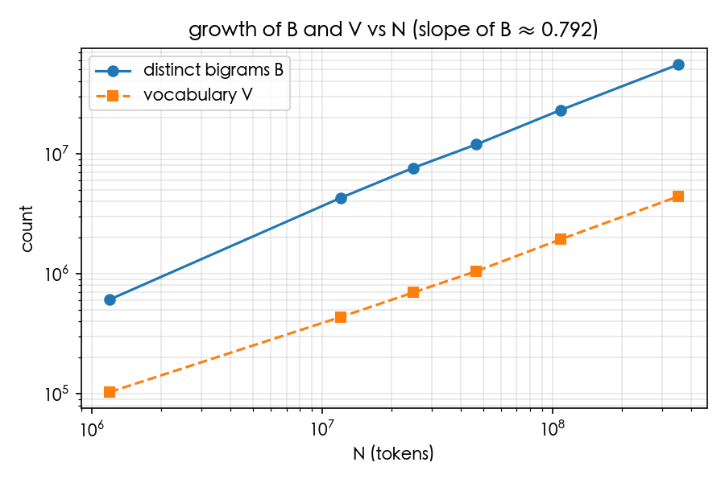
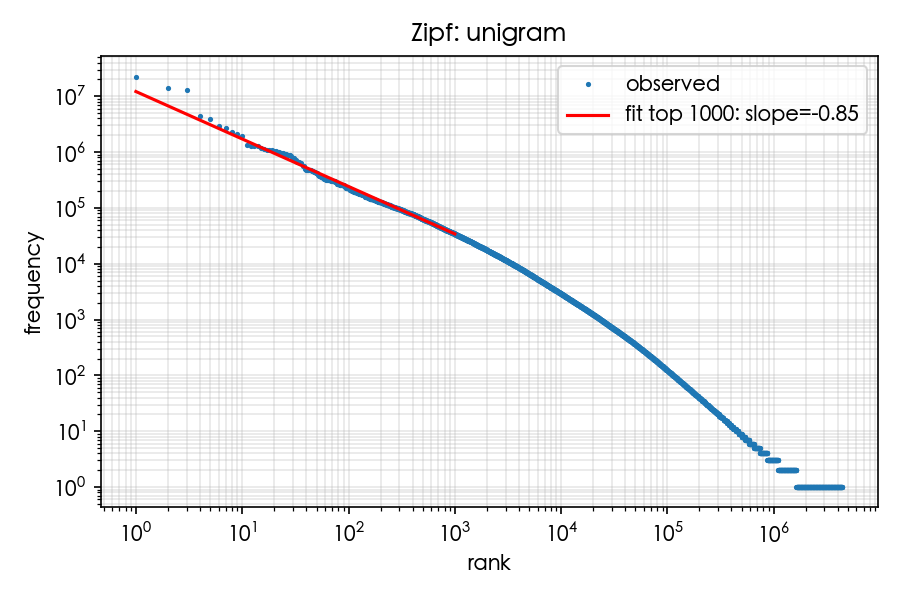
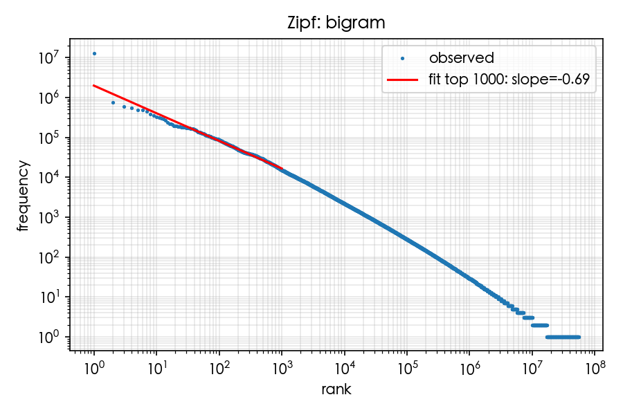

# 資訊檢索 HW1：中文維基 Word Bigram 語言模型

學號：＿＿＿＿＿＿　姓名：＿＿＿＿＿＿

- 語料：`wiki_article_list_2023_tra.json`（2023 年繁體中文維基百科，1,653,168,225 bytes，1,323,055 篇文章）
- 模型：word bigram（作業本體）與 word trigram（加分題），純 MLE，不做平滑
- 程式：`hw1/` 套件與 `python -m hw1` 命令列；展示用 notebook 在 `report/showcase.ipynb`

數字出處：Part 1 取自 `data/counts/full/meta.json` 與 `results/notes.md`，Part 3 與加分題取自 `results/full/` 的 `q1`～`q5`、`zipf`、`trigram` 結果檔。少數數字是寫報告時另外執行 CLI 指令或 grep 原始語料得到的，旁邊會註明「CLI」或「grep」；標明「bigram 表」的是直接讀 `data/counts/full/` 的 bigram 表（`bigram_keys.npy`、`bigram_counts.npy`）數出來的；標明「計算」的是由上述數字再算出來的。

| 作業要求 | 章節 |
|---|---|
| 工具與語言 | 0 |
| Part 1：N、V、B、t 與做法 | 1 |
| Part 2：predict、prob、generate | 2 |
| Part 3：五題觀察 | 3.1–3.5 |
| 一個奇怪的現象 | 4 |
| 遇到的問題與解法 | 5 |
| 加分：Zipf 圖、trigram、最通順／最好笑的句子 | 6.1–6.3 |

## 0. 環境與工具

- 語言：Python 3.10.0，用 uv 0.11.7 管理虛擬環境（`.python-version` 固定 3.10）
- 套件：jieba 0.42.1（精確模式、HMM 開啟、字典 `dict.txt.big`）、numpy 2.2.6、matplotlib 3.10.9；測試用 pytest
- 機器：Apple M5、10 核、24 GB RAM、macOS 26.5.2
- 斷詞開 10 個行程，每個任務 2,000 篇文章（meta.json 的 `workers`、`chunk_size`）

程式碼結構：

| 檔案 | 內容 |
|---|---|
| `hw1/corpus.py` | 逐行讀 JSON 陣列、分句、輸出前 N 篇子集 |
| `hw1/segment.py` | jieba 斷詞、加 `<s>` `</s>`、多行程把文章編成本地 int32 ID |
| `hw1/counting.py` | 合併各塊詞表成一條 token 串流；unigram／bigram／trigram 計數；`run_count` 串起整個 Part 1 |
| `hw1/store.py` | 計數結果的存檔與載入（`.npy`、`vocab.txt`、`meta.json`） |
| `hw1/timing.py` | 計時並寫入 `timings.json` |
| `hw1/model.py` | `BigramModel`、`TrigramModel`：`predict`、`prob`、`generate` |
| `hw1/analysis.py` | Part 3 五題、Zipf 圖、trigram 比較，輸出到 `results/` |
| `hw1/cli.py` | 命令列入口 |
| `tests/` | 61 個 pytest 單元測試（玩具語料手算）；`tests/integration/` 是 `sort \| uniq -c` 對照腳本 |

CLI 指令：

```bash
uv run python -m hw1 subset       --corpus <json> --n-articles N --out <json>
uv run python -m hw1 count        --corpus <json> --out data/counts/<name> [--limit N] [--workers 10] [--trigram]
uv run python -m hw1 dump-bigrams --counts <dir> --out <txt>    # 每行 w1<TAB>w2，給 sort | uniq -c 對照
uv run python -m hw1 top-bigrams  --counts <dir> [--k 20]
uv run python -m hw1 predict  <w> <k>   [--counts data/counts/full]
uv run python -m hw1 prob     "<句子>"  [--counts ...] [--trigram]
uv run python -m hw1 generate --seed <s> --n N --mode greedy|sample [--rng-seed S] [--trigram] [--counts ...]
uv run python -m hw1 analyze  [--counts data/counts/full] [--out results/full]
```

重現全部結果：

```bash
uv sync
uv run python -m hw1 count --corpus data/wiki_article_list_2023_tra.json --out data/counts/full --workers 10 --trigram
uv run python -m hw1 analyze --counts data/counts/full --out results/full
```

## 1. Part 1 數

### 1.1 做法

**讀取。** 語料是一個 JSON 陣列：第一行 `[`、最後一行 `]`，中間每行是一篇文章字串，行尾帶逗號。1.65 GB 的檔案整個 `json.load` 太佔記憶體，所以逐行讀：跳過只有 `[` 或 `]` 的行，去掉行尾逗號，再對那一行 `json.loads`。解析失敗算壞行、空字串算空文章，都跳過並計數。全語料讀到 1,323,055 篇，`skipped_bad_lines = 0`、`skipped_empty_articles = 0`（meta.json），這份語料沒有壞行也沒有空文章。

**分句。** 以 `。！？` 為句尾，標點留在該句句尾；文章結尾也算句尾；空句丟棄。句尾標點後面如果緊接閉合符號（`」』）)〕】》`），把它們併回前一句。例如 `他說「好。」然後離開。` 會切成 `他說「好。」` 和 `然後離開。`，不會讓下一句以 `」` 開頭。全語料共 13,373,820 句（meta.json）。

**標記。** 斷詞之後才在每句前後加 `<s>`、`</s>`，標記不經過 jieba（否則 `<s>` 會被切成 `<`、`s`、`>`）。`<s>` 的 ID 固定為 0，`</s>` 固定為 1。前一句的 `</s>` 和下一句的 `<s>` 不算詞對。

**token 清理。** jieba 切出的純空白 token 丟掉，其他全部保留，包括標點、數字和英文字串。所以「，」「。」也是詞，這直接影響後面的結果：全語料最常見的 bigram 是 (`。`, `</s>`)，13,054,207 次（notes.md 前 20 名）。

**斷詞。** jieba 0.42.1 精確模式，字典換成 `dict.txt.big`。jieba 的預設字典以簡體詞為主，碰到繁體字很容易切壞。下面是語料第一篇文章第一句，用兩個字典各跑一次的實際結果：

```
原句          引渡是一個國際執法的概念，指一個司法管轄區將在另一個司法管轄區被指控或被定罪的人，移交給當時國的執法部門的行動。
預設字典      … 概念 / ， / 指一個 / 司法 / 管轄區將 / 在 / 另 / 一個 / … / 移交 / 給當 / 時國 / 的 / …
dict.txt.big  … 概念 / ， / 指 / 一個 / 司法 / 管轄區 / 將在 / 另 / 一個 / … / 移交 / 給 / 當時 / 國的 / …
```

預設字典切出「指一個」「管轄區將」「給當／時國」，dict.txt.big 改成「指／一個」「管轄區」「給／當時」。另一句「他出生於1950年，畢業於國立臺灣大學。」，預設字典切成「國立／臺／灣大學」，dict.txt.big 是「國立／臺灣大學」。dict.txt.big 也不完美：jieba 的 HMM 會把字典路徑上相鄰的單字合成未登錄詞，所以出現「將在」「國的」，還有 3.5 節會看到的「他出／生於」。我照 spec 保留 HMM（精確模式的預設），因為關掉它雖然沒有這類合併，字典沒收的詞也會被拆成單字，例如「台灣」會變成「台／灣」。

**計數。**

1. 每個 worker 回傳自己的本地詞表和本地 int32 ID 陣列。主行程維護全域詞表，對每一塊建「本地 ID → 全域 ID」的查表陣列，用一次 numpy fancy indexing 重映射，再接成一條 int32 token 串流（3.52 億個 token，`tokens.npy` 約 1.41 GB）。
2. unigram：`np.bincount(tokens)`。
3. bigram：把 `w1 << 32 | w2` 打包成一個 int64 key，刪掉 `w1 = </s>` 的位置（跨句），再 `np.unique(key, return_counts=True)`。得到排序好的 key 陣列和次數陣列，同一個 w1 的所有後繼剛好是連續的一段，查詢時用 `searchsorted` 就找得到。
4. trigram：對每個位置用 `searchsorted` 查出 (w1, w2) 在 bigram 表裡的序號，`key3 = 序號 << 32 | w3`，刪掉 w1 或 w2 是 `</s>` 的位置，再 `np.unique`。key3 的高 32 位元指回 bigram 表，所以 P(w3 | w1, w2) = count(w1, w2, w3) / count(w1, w2) 查兩次表就有。

**驗證。**

玩具語料 `tests/fixtures/toy.json` 有兩篇文章 `我喜歡你。我喜歡他。`、`我討厭你。`，共三句。斷詞加標記後是 `<s> 我 喜歡 你 。 </s>`、`<s> 我 喜歡 他 。 </s>`、`<s> 我 討厭 你 。 </s>`，N = 18。手算的表和程式結果一致（單元測試）：

| unigram | `<s>` | `</s>` | 我 | 喜歡 | 你 | 。 | 他 | 討厭 |
|---|---|---|---|---|---|---|---|---|
| 次數 | 3 | 3 | 3 | 2 | 2 | 3 | 1 | 1 |

| bigram | (`<s>`, 我) | (我, 喜歡) | (我, 討厭) | (喜歡, 你) | (喜歡, 他) | (討厭, 你) | (你, 。) | (他, 。) | (。, `</s>`) |
|---|---|---|---|---|---|---|---|---|---|
| 次數 | 3 | 2 | 1 | 1 | 1 | 1 | 2 | 1 | 3 |

V = 8、B = 9，bigram 總次數 15 = 18 − 3（每句的 `</s>` 後面沒有詞對）；trigram 有 10 種、總次數 12 = 18 − 3 × 2。P(我喜歡你。) = 1 × 2/3 × 1/2 × 1 × 1 = 1/3 也有測試。全部 61 個測試通過。

1% 子集（前 13,230 篇）用 `dump-bigrams` 把每個詞對寫成一行文字，交給 `LC_ALL=C sort | uniq -c` 獨立計數，再和 numpy 的結果比對（`tests/integration/check_sort_uniq.sh`）：

```
B numpy=4265006 sort|uniq=4265006
top-20 count mismatches: {}
OK
```

dump 出的 11,587,499 行等於 meta 的 `bigram_tokens_total`，`uniq -c` 的次數總和也是 11,587,499。

全語料的帳也對得上：`bigram_tokens_total` 338,983,964 = N − 句數 = 352,357,784 − 13,373,820；`trigram_tokens_total` 325,610,144 = N − 2 × 句數。Q4 從全語料的 token 串流切出前 1% 重算，得到 N = 12,013,994、V = 434,997、B = 4,265,006，和獨立跑的 1% 子集完全相同。

### 1.2 數字

| 項目 | 含 `<s>` `</s>` | 不含標記 |
|---|---|---|
| N（token 總數） | 352,357,784 | 325,610,144 |
| V（相異 token 數） | 4,401,986 | 4,401,984 |
| B（相異 bigram 數，不含跨句詞對） | 55,153,238 | — |
| T（相異 trigram 數，加分題用） | 157,991,994 | — |

B 包含 (`<s>`, w) 和 (w, `</s>`) 這類詞對，只排除跨句的 (`</s>`, `<s>`)。N 的兩欄相差 26,747,640 = 2 × 13,373,820 句。

| 計時 t | 秒 |
|---|---|
| 斷詞（讀檔、分句、jieba、編 ID、合併詞表；10 個行程） | 1,000.706 |
| bigram 計數（打包 + `np.unique`） | 59.833 |
| unigram 與其他（計算：總計減其餘三項） | 8.802 |
| trigram 計數（加分題才需要） | 651.614 |
| 總計 `time_total_s` | 1,720.955 |
| 實際經過時間（`/usr/bin/time`，含 Python 啟動與存檔） | 1,744.50 |

只算作業要求的 unigram 和 bigram，t ≈ 1,720.955 − 651.614 = 1,069.3 秒（約 17.8 分鐘），其中斷詞佔 94%。

**1% 子集的推估與實際比較。** 跑全語料前，先用前 13,230 篇（1%）試跑：N = 12,013,994（不含標記 11,161,004）、V = 434,999（不含標記 434,997）、B = 4,265,006、T = 8,381,788，斷詞 23.343 秒、bigram 計數 0.43 秒、總計 33.439 秒（notes.md）。

| 項目 | 推估方法 | 推估值 | 全語料實際 |
|---|---|---|---|
| N | 1% 子集 × 100 | 1,201,399,400 | 352,357,784 |
| 斷詞時間 | 1% 子集 × 100 | 2,334 秒 | 1,000.7 秒 |
| 斷詞時間 | 依 token 比例（子集佔全語料 3.41%） | 685 秒 | 1,000.7 秒 |
| bigram 計數時間 | 依 token 比例 | 12.6 秒 | 59.8 秒 |

照篇數乘 100 會高估 3.4 倍，因為前 1% 的文章特別長：篇數是 1%，token 卻佔 3.41%（12,013,994 / 352,357,784）。改用 token 比例推估，斷詞時間實際慢了 46%。我認為斷詞變慢主要是記憶體不夠：執行期間其他程式佔了約 13 GB，系統大量 swap（notes.md）；`/usr/bin/time` 記到 user 3,439.01 秒、sys 1,231.83 秒，sys 時間高得不尋常，整段執行（含單執行緒的計數階段）平均只有約 2.7 顆核心在工作（計算：(3,439.01 + 1,231.83) / 1,744.50），10 個 worker 遠沒有吃滿。bigram 計數差了 4.7 倍則不完全是 swap：Q4 後來重算 100% 那一列（bigram 加 unigram）也花了 49.8 秒。`np.unique` 是排序，key 陣列從 1% 的約 93 MB 變成全語料的約 2.7 GB，排序成本和快取效率都不是線性變化，用 0.43 秒線性外推本來就不準。

## 2. Part 2 建

三個函式都在 `hw1/model.py` 的 `BigramModel` 上，載入 `data/counts/full/` 的詞表、unigram 次數和 bigram 表。`TrigramModel` 繼承它，把 `prob`、`generate` 改成用 P(w3 | w1, w2)。

```python
BigramModel.load(counts_dir) -> BigramModel
predict(w: str, k: int) -> list[tuple[str, float]]
prob(sentence: str) -> ProbResult         # logprob（log₂）、斷詞結果、每步 (w1, w2, count, context_count, prob)、第一個未見詞對
generate(seed: str, n: int, mode="greedy" | "sample", rng_seed=None) -> GenerateResult
                                          # words、text、cycle_start、cycle_length、n_sentences
```

### predict(w, k)

找出 key 落在 `[id(w) << 32, (id(w)+1) << 32)` 的那一段，依次數降冪（次數相同時 ID 小的在前）取前 k 個，機率 = 次數 / 該段總和。w 不在詞表就回傳空 list。

```
$ uv run python -m hw1 predict 臺灣 10 --counts data/counts/full
的	0.0592
，	0.0399
總督府	0.0156
。	0.0143
日治	0.0143
清治	0.0102
臺北市	0.0077
府	0.0072
鐵路	0.0056
後	0.0053
```

### prob(sentence)

句子經過和計數時同一套分句、斷詞、加標記函式，逐對查 bigram 並累加 log₂ 機率；有多句就各句分開算再相加。任何一對沒出現過，總值就是 −∞，但每一步的明細照樣保留，並回報第一個未見詞對。

```
$ uv run python -m hw1 prob "臺灣是一個島嶼。" --counts data/counts/full
tokens: <s> 臺灣 是 一個 島嶼 。 </s>
  P(臺灣 | <s>) = 13130/13373820 = 0.000981769
  P(是 | 臺灣) = 860/256718 = 0.00334998
  P(一個 | 是) = 73973/2881972 = 0.0256675
  P(島嶼 | 一個) = 752/767357 = 0.000979987
  P(。 | 島嶼) = 1840/18043 = 0.101979
  P(</s> | 。) = 13054207/13110622 = 0.995697
log2 P = -36.7927
```

### generate(seed, n, mode)

seed 斷詞後取最後一個詞當起點，seed 為空就從 `<s>` 開始。`greedy` 每步取次數最高的後繼；`sample` 依次數比例抽樣，亂數用 `numpy.random.default_rng(rng_seed)`，同一個 rng_seed 可以重現同樣結果。候選詞排除 `<s>`；抽到 `</s>` 時輸出「｜」代表句尾，再從 `<s>` 開新句，直到湊滿 n 個詞。greedy 另外回報第一次回到走過的狀態是第幾步（`cycle_start`）和循環長度（`cycle_length`），循環的起點是兩者相減。

```
$ uv run python -m hw1 generate --seed 臺灣 --n 30 --mode greedy --counts data/counts/full
的一個市鎮，是一個市鎮，是一個市鎮，是一個市鎮，是一個市鎮，是一個市鎮，是一個市鎮，是一個
cycle_start=6 cycle_length=4 sentences=0

$ uv run python -m hw1 generate --seed 臺灣 --n 30 --mode sample --rng-seed 0 --counts data/counts/full
因財政大臣，偕同佛母白度母為科學使用者並不存在極少數的動畫片《獨處。 ｜ 1947年，該書涵蓋政治學專業拆機報告還尚未
```

第 s 步是用當時的狀態（bigram 是最後一個詞，第 0 步是 seed）選出第 s+1 個詞。上面的 `cycle_start=6` 表示第 6 步的狀態「一個」在第 2 步就出現過，所以循環從第 6 − 4 = 2 步開始。

### predict 的分母

P(w2 | w1) 的分母應該是「w1 後面接了東西的次數」。程式直接用 w1 那一段 bigram 次數的總和，不另外查 unigram count(w1)。兩者其實相等：每句都以 `</s>` 結尾，所以除了 `</s>` 本身，每個 token 在同一句內後面一定還有一個 token。單元測試在玩具語料上逐詞檢查「區間總和 = unigram 次數」，並檢查 predict 的機率加總為 1（誤差 1e-9）。全語料上也看得到：上面 P(是 | 臺灣) 的分母 256,718 正好是 Q2 表中「臺灣」的出現次數，P(臺灣 | `<s>`) 的分母 13,373,820 就是句數。唯一的例外是 `</s>`，它沒有後繼，predict(`</s>`) 回傳空 list。

## 3. Part 3 看

### 3.1 Q1：greedy 為什麼繞圈，sample 為什麼不會

設定：seed 用 台灣、他、的、1990年 和 `<s>`（空 seed），各生成 50 個詞；greedy 跑一次，sample 用 rng_seed 0、1、2 各跑一次。完整輸出在 `results/full/q1.md`。

bigram greedy：

| seed | 輸出開頭 | 循環起點（第幾步） | 第一次回到走過的狀態（第幾步） | 循環長度 |
|---|---|---|---|---|
| 台灣 | `的一個市鎮，是一個市鎮，是一個市鎮，…` | 2 | 6 | 4 |
| 他 | `的一個市鎮，是一個市鎮，是一個市鎮，…` | 2 | 6 | 4 |
| 的 | `一個市鎮，是一個市鎮，是一個市鎮，…` | 1 | 5 | 4 |
| 1990年 | `，是一個市鎮，是一個市鎮，是一個市鎮，…` | 1 | 5 | 4 |
| `<s>` | `在《》，是一個市鎮，是一個市鎮，…` | 4 | 8 | 4 |

循環起點 = `cycle_start` − `cycle_length`（`results/full/q1.md`、`q1.json`）。

bigram 第 s 步（s ≥ 1）的狀態就是第 s 個輸出詞，所以循環起點也是圈裡第一個詞在輸出中的位置：台灣、他 從第 2 個詞「一個」開始繞，的、1990年 從第 1 個詞就在圈裡，`<s>` 先走過「在《》」，從第 4 個詞「，」開始。五個 seed 都在前 4 個詞內掉進同一個長度 4 的循環「是一個市鎮，」，50 個詞裡一次句尾都沒有（`n_sentences = 0`）。

bigram sample 的幾個例子：

| seed／rng_seed | 輸出（「｜」是句尾） |
|---|---|
| 台灣／1 | `超過格拉斯哥大學西奈山的由來習性不明。 ｜ 常規步兵科只有18世紀的劇本。 ｜ 每屆任期四年國泰虐民甚於2003年，名庚，…` |
| 的／2 | `一位出旺盛，表現入選明星賽。 ｜ 軼事據日本有線數字電視於固守疲敵”。 ｜ …` |
| 1990年／2 | `3月的第23。 ｜ 《天堂共和國總理，形成一對老夫妻住老婆未確認，不做祖母正是當年仇思達2002年，…` |

15 次 sample 輸出裡都沒有重複的片段（程式只在 greedy 模式偵測循環，這裡是逐條看輸出），每 50 個詞有 1 到 3 個句尾。

**greedy 為什麼繞圈。** bigram greedy 的下一個詞只由目前這個詞決定，而且是固定的函數。詞表有限，走得夠久一定會回到走過的詞（鴿籠原理），之後就照原路一直重複。這個循環的每一步都是該詞的第一名後繼（CLI `predict`）：

| 目前的詞 | 第一名後繼 | 機率 | 第二名 |
|---|---|---|---|
| ， | 是 | 0.0244 | 在 0.0212 |
| 是 | 一個 | 0.0257 | 在 0.0238 |
| 一個 | 市鎮 | 0.0887 | 鄉鎮級 0.0437 |
| 市鎮 | ， | 0.2145 | 。 0.1791 |

「，」是全語料最常見的 token（22,575,166 次，CLI prob 的分母），任何起點走幾步幾乎都會碰到它，所以五個 seed 都被吸進同一個圈。「市鎮」後面接「，」(0.2145) 比接「。」(0.1791) 多一點，greedy 就永遠結束不了句子。greedy 選的「最可能」其實很弱：「，」之後選「是」的機率只有 2.44%，真實文本有 97.56% 不是這樣接的。

循環的內容會隨語料量改變。1% 子集上的 greedy 循環是「但在《》，」（長度 5，`results/p1/trigram.md`），全語料變成「是一個市鎮，」，因為全語料中 (，, 是) 有 550,345 次，超過 (，, 在) 的 478,604 次和 (，, 但) 的 453,874 次（notes.md 前 20 名）。「一個」後面接「市鎮」有 68,076 次（P(市鎮 | 一個) = 68076/767357，CLI），地名小條目的固定句型多到足以決定 greedy 的路線。

**sample 為什麼不會。** sample 每一步依機率抽，要剛好重走「是 → 一個 → 市鎮 → ，」一整圈，機率是 0.0244 × 0.0257 × 0.0887 × 0.2145 ≈ 1.2 × 10⁻⁵（計算），連續兩圈更不可能。代價是 sample 的句子只保證相鄰兩個詞在語料中接過，整句沒有意思，例如「常規步兵科只有18世紀的劇本。」。

**同一個 rng_seed 會讓不同 seed 的輸出合流。** q1.md 裡 rng_seed = 0 的那幾列，台灣、他、的、1990年 四個 seed 的後半段一字不差，都是「…。 ｜ 1947年，該書涵蓋政治學專業拆機報告還尚未抵達義大利足球的…」。我用相同設定重跑並逐詞比對：他、的、1990年 從第 18 個詞起和 台灣 完全相同；第 17 個詞在 他／的／1990年 是「困難」，在 台灣 是「獨處」，第 18 個詞卻都抽到「。」。`<s>` 則從第 22 個詞起合流。原因是 numpy 的 `choice` 每一步只用一個均勻亂數 u，看 u 落在累積機率的哪一格。rng_seed 相同時，每一步的 u 也相同；兩條路線只要在同一步抽到同一個詞（「。」在很多詞後面都佔很大一格，很容易發生），之後的狀態和亂數就完全一樣，再也分不開。所以要比較不同 seed 的抽樣結果，應該換用不同的 rng_seed，否則看到的相似只是共用了亂數。

trigram 的 greedy 也會繞圈，循環長度 21，詳見 6.2。

### 3.2 Q2：「的」和「台灣」，哪個後面比較好預測

| 詞 | 出現次數 | 後繼種類 | top1 機率 | top10 機率和 | 條件熵 (bits) | 困惑度 |
|---|---|---|---|---|---|---|
| 的 | 13,828,677 | 398,677 | 0.0214 | 0.0714 | 13.410 | 10,883.5 |
| 台灣 | 52 | 44 | 0.1346 | 0.3462 | 5.246 | 37.9 |
| 臺灣 | 256,718 | 17,908 | 0.0592 | 0.1793 | 10.337 | 1,293.2 |

前 10 名後繼（`results/full/q2.md`）：

- 的：一個 (0.021)、， (0.008)、。 (0.008)、《 (0.007)、「 (0.006)、是 (0.005)、“ (0.005)、人 (0.004)、主要 (0.003)、一部分 (0.003)
- 台灣：的 (0.135)、於 (0.038)、北部 (0.038)、， (0.019)、在 (0.019)、有 (0.019)、最 (0.019)、政府 (0.019)、`)` (0.019)、主要 (0.019)
- 臺灣：的 (0.059)、， (0.040)、總督府 (0.016)、。 (0.014)、日治 (0.014)、清治 (0.010)、臺北市 (0.008)、府 (0.007)、鐵路 (0.006)、後 (0.005)

衡量方式是條件熵 H(W | w) = −Σ p(w′ | w) log₂ p(w′ | w)：熵越低，下一個詞越好猜。困惑度 2^H 可以理解成「相當於從幾個等機率的詞裡猜一個」。

**先處理「台灣」這個寫法。** 這份語料幾乎都寫「臺」。斷詞後「台灣」只有 52 次，「臺灣」有 256,718 次，相差 4,937 倍；grep 原始語料，含「台灣」的文章只有 69 篇，含「臺灣」的有 84,006 篇。dict.txt.big 收了「臺灣」（詞頻 8683），沒收「台灣」；「台灣」能成為一個詞，是 jieba 的 HMM 把「台」「灣」兩個單字合起來的。

照題目問的「台灣」，熵是 5.246 bits，比「的」低很多，但這是建立在 52 次觀察上的數字。52 次觀察算出的經驗熵最多只有 log₂ 52 ≈ 5.70 bits（計算）；44 種後繼裡大多只出現一次，連第一名「的」也只有 7 次（0.1346 × 52），分布根本還沒看清楚。熵的 MLE 估計在樣本少時會偏低，從 1% 子集就看得出來：「臺灣」在 1% 子集出現 8,849 次，熵 9.393 bits，到全語料 256,718 次時升到 10.337 bits；「台灣」在 1% 子集只有 2 次，熵 1.000 bits（`results/p1/q2.md`）。所以「台灣」的 5.246 bits 主要反映樣本太少，不能拿來下結論。

**用語料實際的寫法「臺灣」比。** 臺灣 10.337 bits，的 13.410 bits，差 3.07 bits；困惑度 1,293.2 對 10,883.5，可選的詞大約少了 8.4 倍（計算）。前 10 名就佔了 17.9% 的機率，「的」只有 7.1%。所以答案是：「台灣／臺灣」後面比「的」好預測。

原因在詞性。「的」是結構助詞，後面幾乎可以接任何名詞或名詞片語，有 398,677 種後繼，約佔整個詞表的 9.1%（計算），第一名「一個」也只有 2.1%。「臺灣」是專有名詞，後面常接機構和時代名稱：總督府、日治、清治、臺北市、鐵路，機率集中在這些詞上。

### 3.3 Q3：看過的詞對佔 V × V 的比例

- V（不含標記）= 4,401,984
- V² = 19,377,463,136,256（約 1.94 × 10¹³）
- B = 55,153,238
- B / V² = 2.846 × 10⁻⁶，也就是 0.00028%
- 平均每個詞有 12.53 種不同後繼（B / V）

（B 含 (`<s>`, w)、(w, `</s>`) 這類有標記的詞對，V 則不含標記。有標記的詞對共 680,198 + 22,777 = 702,975 種：`<s>` 後面接過 680,198 種詞，`</s>` 前面出現過 22,777 種詞（bigram 表），只佔 B 的 1.275%（計算）；扣掉它們，比例是 2.810 × 10⁻⁶（計算），結論不變。）

所有可能的詞對中，看過的不到百萬分之三。我認為原因有四個：

1. 語料本身裝不下。全語料總共只有 338,983,964 個 bigram（含重複，meta 的 `bigram_tokens_total`），就算每一個都不同，最多也只能填滿 V² 的 1.75 × 10⁻⁵（計算）。V² 是語料詞對總數的 5.7 萬倍。
2. 實際出現的詞對又高度重複。3.39 億個詞對只有 5,515 萬種，每種平均出現 6.1 次（計算）。這是 Zipf 分布的結果（6.1 節）：少數高頻詞，例如「，」「的」「。」，彼此反覆搭配，吃掉大部分次數。
3. 詞表的大宗是罕見詞。unigram Zipf 圖右端有一大段頻率為 1 的平台（從圖上看大約是排名 10⁶ 以後），只出現一次的詞最多只能帶出一種後繼。V 裡還有不少語料雜訊，例如 sample 輸出裡的 `ltaasvxtxaasvxtxgt`、`-zh-hans`。每多一個只出現一次的 token，V² 就多出約 2V 個可能的詞對，B 卻只多一兩個。
4. 語法和語意本來就排除大部分組合，例如 Q5 的 (香蕉, 打電話) 是 0/2,178。

這個比例的後果是：MLE 把 99.9997% 的詞對機率設為 0，一句話只要用到一個沒見過的搭配，機率就是 −∞（3.5 節）。要讓模型處理新句子，一定要做平滑或 backoff，這次作業依規定沒有做。

### 3.4 Q4：語料增加時 B 怎麼長

從全語料 token 串流切前綴（依篇數），在六個比例重算（`results/full/q4.md`；N 含標記，V 不含標記）：

| 比例 | 篇數 | N | V | B | B/N | 計數秒數 |
|---|---|---|---|---|---|---|
| 0.1% | 1,323 | 1,193,883 | 103,065 | 607,947 | 0.509 | 0.07 |
| 1% | 13,230 | 12,013,994 | 434,997 | 4,265,006 | 0.355 | 0.42 |
| 3% | 39,691 | 24,791,284 | 694,920 | 7,578,418 | 0.306 | 0.9 |
| 10% | 132,305 | 46,736,018 | 1,047,637 | 11,911,585 | 0.255 | 1.79 |
| 30% | 396,916 | 108,459,699 | 1,930,288 | 23,017,175 | 0.212 | 4.73 |
| 100% | 1,323,055 | 352,357,784 | 4,401,984 | 55,153,238 | 0.157 | 49.8 |



log-log 擬合得到 B ∝ N^0.792。用同樣方法擬合 V（計算自 q4.json），V ∝ N^0.659。

- B 一直在長，沒有飽和的跡象。資料變 10 倍，B 約變 10^0.792 ≈ 6.2 倍。相鄰兩點之間的局部斜率是 0.844、0.794、0.713、0.782、0.742（計算），在 0.71 到 0.84 之間跳動，沒有往 0 收斂。
- 每個 token 帶來的新詞對越來越少：B/N 從 0.509 降到 0.157。在全語料的規模，dB/dN ≈ 0.792 × 0.157 ≈ 0.12（計算），也就是每多 100 個 token 大約多 12 種新詞對。
- 平均每個詞的後繼種類 B/V 從 5.90 增加到 12.53（計算），因為 B 長得比 V 快（0.792 > 0.659）。

**和 Heaps' law 的類比。** Heaps' law 描述詞彙量隨語料長度的成長：V = K · N^β，β < 1。語料越大，新詞越難遇到，但人名、地名、數字和外文永遠會帶來新詞。這裡 V 的指數 0.659 就是這份語料的 β。B 也符合同樣的形式，指數 0.792 更大。我的解釋是新詞對有兩個來源：一是新詞本身，每個新詞至少帶來一個新詞對；二是舊詞之間的新組合。V 已經很大時，第二個來源還遠遠沒用完，V 個詞有 V² 種組合，而 Q3 顯示這個空間幾乎是空的，所以 B 比 V 更晚飽和。1% 子集內部做同樣的分析（13 到 13,230 篇），斜率是 0.888（`results/p1/q4.md`），比全語料大；全語料的表中也是最前段（0.1% → 1%）的局部斜率 0.844 最高，規模小時 B 長得比較快。

要注意這些子集是語料前綴，不是隨機抽樣。前段文章比較長（0.1% 的篇數佔 0.34% 的 token，1% 的篇數佔 3.41%），主題也可能不平均，所以指數描述的是這份語料前綴的成長，換成隨機抽樣可能略有不同。

### 3.5 Q5：自己寫的句子

spec 規定的 6 句（3 句百科體、2 句口語、1 句亂湊），再加 2 句把「台」改成「臺」的對照句（`results/full/q5.md`）：

| 類型 | 句子 | 詞數 | bigram log₂P | bigram 第一個未見 | trigram log₂P | trigram 第一個未見 |
|---|---|---|---|---|---|---|
| 百科體 | 台灣是一個位於東亞的島嶼。 | 8 | −∞ | (`<s>`, 台灣) | −∞ | (`<s>`, 台灣) |
| 百科體 | 他出生於1950年，畢業於國立臺灣大學。 | 10 | −61.40 |  | −∞ | (他出, 生於, 1950) |
| 百科體 | 該公司成立於2001年，總部位於台北市。 | 11 | −∞ | (位於, 台北市) | −∞ | (總部, 位於, 台北市) |
| 口語 | 我今天早上吃了一個很好吃的蛋餅。 | 11 | −96.17 |  | −∞ | (今天, 早上, 吃) |
| 口語 | 你等一下要不要一起去看電影？ | 10 | −99.85 |  | −∞ | (等, 一下, 要) |
| 亂湊 | 香蕉打電話給星期三的數學。 | 7 | −∞ | (香蕉, 打電話) | −∞ | (`<s>`, 香蕉, 打電話) |
| 百科體（臺） | 臺灣是一個位於東亞的島嶼。 | 8 | −62.12 |  | −52.25 |  |
| 百科體（臺） | 該公司成立於2001年，總部位於臺北市。 | 11 | −61.03 |  | −51.90 |  |

詞數不含 `<s>` `</s>`，含標點。trigram 每句第一步用 bigram（句首只有一個前文詞），所以第一句的 trigram 也停在 (`<s>`, 台灣)。

**百科體 vs 口語。** 句子長度不同，所以比「每步平均 log₂P」。步數 = 詞數 + 1，最後一步是預測 `</s>`（計算自上表）：

| 句子 | 類型 | 步數 | bigram log₂P | 每步平均 |
|---|---|---|---|---|
| 該公司成立於2001年，總部位於臺北市。 | 百科體（臺） | 12 | −61.03 | −5.09 |
| 他出生於1950年，畢業於國立臺灣大學。 | 百科體 | 11 | −61.40 | −5.58 |
| 臺灣是一個位於東亞的島嶼。 | 百科體（臺） | 9 | −62.12 | −6.90 |
| 我今天早上吃了一個很好吃的蛋餅。 | 口語 | 12 | −96.17 | −8.01 |
| 你等一下要不要一起去看電影？ | 口語 | 11 | −99.85 | −9.08 |

百科體每步 −5.1 到 −6.9 bits，口語 −8.0 到 −9.1 bits。兩組平均是 −5.86 對 −8.55 bits（計算），相差約 2.7 bits，也就是口語每個詞的機率平均小約 6.4 倍。明細可以看出差在哪裡：

- 百科體用的是維基的固定句型，好幾步機率很高：P(年 | 2001) = 75517/80004 = 0.944、P(生於 | 他出) = 909/981 = 0.927、P(於 | 畢業) = 29653/73337 = 0.404。
- 口語的詞在百科裡很少見：P(我 | `<s>`) = 7083/13373820，只有 P(該 | `<s>`) = 104624/13373820 的 1/15；P(要 | 一下) = 1/2631；P(蛋餅 | 的) = 11/13828677；問句結尾 P(？ | 電影) = 11/175111。維基很少用第一、二人稱，也很少有問句。

**第一個未見詞對。** bigram 下 8 句有 3 句是 −∞：

- 「台灣是一個位於東亞的島嶼。」第一對 (`<s>`, 台灣) 就是 0/13,373,820，全語料沒有一句以「台灣」開頭，下一對 (台灣, 是) 也是 0/52。改成「臺灣」後，P(臺灣 | `<s>`) = 13130/13373820、P(是 | 臺灣) = 860/256718，整句 −62.12。
- 「該公司成立於2001年，總部位於台北市。」的 (位於, 台北市) 是 0/477,626；(位於, 臺北市) 有 797 次，臺北市版本是 −61.03。
- 「香蕉打電話給星期三的數學。」的 (香蕉, 打電話) 是 0/2,178，後面的 (給, 星期三) 也是 0/57,238。其他詞對都很正常，例如 P(的 | 星期三) = 68/1654；bigram 只看相鄰兩個詞，「星期三的數學」在它眼裡沒有問題。

**MLE 不平滑的後果。** 只要一個詞對沒見過，整句就是 −∞，而所有 −∞ 的句子之間分不出高下。一句正確、只是用了「台」字的百科句，和一句胡亂拼湊的句子拿到一模一樣的分數；模型分不出「沒見過是因為寫法少見」和「沒見過是因為不通」。增加語料能消掉一部分 −∞：同樣 8 句在 1% 子集上有 6 句是 −∞（`results/p1/q5.md`），全語料剩 3 句，「他出生於…」和兩句口語都是靠更多資料才變成有限值。但「台灣」那兩句的問題出在寫法，同一份語料再多也不會改善。

**jieba 的影響。** 「他出生於」被切成「他出／生於」。dict.txt.big 裡「生於」的詞頻是 4690、「出生」是 1979，jieba 的最大機率路徑選了「他／出／生於」，HMM 再把相鄰的單字「他」「出」合成未登錄詞「他出」；關掉 HMM 就是「他／出／生於」。「成立於」同樣被切成「成／立於」。計數和查詢用同一套斷詞，所以 bigram 不受影響，P(生於 | 他出) = 909/981 甚至很高；但語料中的「出生於」依前一個字不同而被切成不同 token，統計量也跟著分散。trigram 的第一個未見三元組正是 (他出, 生於, 1950)：(他出, 生於) 在語料出現 909 次，沒有一次後面接 1950。

**模型自己生成的句子分數更高。** 用 CLI 算 bigram greedy 的開頭「在《》，是一個市鎮。」（取 greedy 開頭並把句尾改為「。」），log₂P = −35.46，比「臺灣是一個島嶼。」的 −36.79 還高；每步平均是 −3.94 對 −6.13 bits（計算）。語言模型評的是「像不像這份語料」，不是「通不通」。帶著空書名號的句子，在這份語料裡反而很典型（第 4 節）。

## 4. 一個奇怪的現象：空的《》和「」

bigram greedy 從 `<s>` 出發，寫出的第一句是「在《》，是一個市鎮，…」；trigram greedy 的循環句是「在《》，是下轄的一個市鎮，…」。書名號裡是空的。這不是生成程式的問題，語料裡本來就有大量空括號：

| 觀察 | 數字 | 出處 |
|---|---|---|
| 《 後面最常接 》 | P(》 \| 《) = 54,650 / 1,295,204 = 0.042 | CLI prob |
| 「 後面最常接 」 | P(」 \| 「) = 0.0206 | CLI predict |
| 含「《》」的文章 | 22,178 篇 | grep 原始語料 |
| 含「「」」的文章 | 9,910 篇 | grep 原始語料 |
| 「的」的第 4、5 名後繼 | 《 0.007、「 0.006 | q2.md |
| (是, 下轄) 後面接「的」 | 37,079 / 37,086 | CLI prob --trigram |
| 全形「（」與半形「(」 | 語料 0 行，詞表裡沒有 | grep |
| 半形「)」 | 99,528 篇文章含有；也是「台灣」的後繼之一 (0.019) | grep、q2.md |
| 「！」「!」「；」 | 語料 0 行 | grep |

「是下轄的一個市鎮」最能說明狀況。正常寫法是「X 是〔某地〕下轄的一個市鎮」，「是」和「下轄」之間應該有地名，但語料裡「是 下轄」出現 37,086 次，其中 37,079 次接著「的」。

我的解釋是：這份語料從維基原始碼轉成純文字時，把連結或模板產生的文字丟掉了。`《[[某作品]]》` 變成「《》」，`[[某地]]下轄的` 變成「下轄的」；括號裡的內容（維基常在括號放外文名、生卒年）連同左括號一起消失，只剩一些半形右括號。整份語料一個「！」或「；」都沒有，看起來也是轉換時被處理掉了。這只是推測，我手上只有轉換後的文字，看不到原始碼。

模型把這些殘缺當成了語言的一部分。bigram 從句首 greedy 走「`<s>` → 在 → 《 → 》 → ，」，每一步都是第一名後繼：P(在 | `<s>`) = 478297/13373820 = 0.036（notes.md 前 20 名的 (`<s>`, 在)）、P(《 | 在) = 46989/3914561、P(》 | 《) = 0.042、P(， | 》) = 152721/1295210 = 0.118（CLI prob）。3.5 節也看到，「在《》，是一個市鎮。」的機率比「臺灣是一個島嶼。」還高。對這個模型來說，「在《》，」就是最典型的維基句子開頭。

## 5. 遇到的問題與解決方式

### 5.1 記憶體：不用 Counter，改用 numpy 打包計數

最直覺的寫法是 `Counter[(w1, w2)] += 1`，但 Python 物件很佔空間。我用 `tracemalloc` 量了一個有 100 萬個不同 key 的 Counter（詞字串事先建好，不計入）：bigram 的 tuple key 每個約 97.9 bytes，trigram 約 105.9 bytes。乘上全語料的種類數：

| | 種類數 | Counter（估計） | numpy（int64 key + int64 次數） |
|---|---|---|---|
| bigram | 55,153,238 | 約 5.4 GB | 882.5 MB |
| trigram | 157,991,994 | 約 16.7 GB | 2,527.9 MB |

兩個 Counter 合計約 22 GB，機器只有 24 GB，而且其他程式（AnyDesk、虛擬機、VS Code）就佔了約 13 GB。所以改成：詞先轉成 int32 ID，兩個 ID 打包成一個 int64，用 `np.unique` 排序計數，每個 key 只要 16 bytes。trigram 不另外存 (w1, w2)，而是存「(w1, w2) 在 bigram 表的序號」，key 還是一個 int64。

即使如此，全語料計數時記憶體仍然很緊：token 串流 1.41 GB，打包出的 bigram key 約 2.7 GB，`np.unique` 排序還要一份副本，計數階段大量 swap。開跑後還發現一個先前留下的 numpy 基準測試行程佔了 7.2 GB，只好手動終止它。

量測上也出過一個錯。第一次看 `/usr/bin/time -l` 的輸出時，把 15,942,136 bytes 誤讀成 15.9 GB；這個數字其實是 uv 啟動器本身的峰值，Python 計數行程的峰值沒有量到。寫報告時我驗證過：同一個 `predict` 指令經由 `uv run` 量到 15,860,192 bytes（約 15.9 MB），直接用 `.venv/bin/python` 執行則是 5,575,627,192 bytes（約 5.6 GB），可見經由 `uv run` 量到的只是啟動器。同一份紀錄（`results/count_full.log`）的 maximum resident set size 是 2,253,963,264 bytes（2.25 GB），比 token 串流加 bigram key 還小，因為大量頁面被換出或壓縮，RSS 不能代表實際用量。

### 5.2 dict.txt.big 不在 pip 版 jieba 裡

`pip install jieba==0.42.1` 只附預設字典 `dict.txt`，`dict.txt.big` 要另外從 jieba 的 GitHub repo（`fxsjy/jieba` 的 `extra_dict/dict.txt.big`）下載。我把它 commit 在 `hw1/resources/dict.txt.big`（584,429 行、8,583,143 bytes），程式用 `jieba.set_dictionary` 指向它，執行時不需要網路。因為是從 master 分支直接下載，沒有版本號，所以記下 SHA-256 `b16011275c42955ccd81fc1adecc93a59dbb7926af69d93fc95d4943d40f6aad` 供核對。

### 5.3 多行程與 jieba 字典載入

斷詞最慢，所以用 10 個行程平行處理，過程中遇到三個問題。

第一，每個行程都要載入一次字典。我用 Pool 的 `initializer` 在每個 worker 啟動時呼叫 `jieba.set_dictionary` 和 `jieba.initialize()`，該行程之後的所有任務共用。jieba 第一次載入新字典時會寫一個快取檔，10 個行程同時寫可能互相干擾，所以主行程先自己初始化一次，把快取建好。

第二，`Pool.imap` 會把整個輸入讀進任務佇列。imap 背後的執行緒會盡快把輸入的可迭代物件全部取完並排進佇列，等於把 1.65 GB 語料全部讀進記憶體。我改成手動 `apply_async`，在途任務最多 2 × workers = 20 個，用 deque 依序取回結果。這樣記憶體用量固定，輸出順序也和語料一致；Q4 的前綴子集要靠這個順序。

第三，spawn 需要 `if __name__ == "__main__":` 保護。程式明確使用 spawn 啟動子行程，子行程會重新 import 主程式。開發時有一個測試腳本沒寫這行，子行程在 import 時又想開一個 Pool，整個卡住約 2 分鐘才發現。正式的 CLI 走 `python -m hw1`，`hw1/__main__.py` 有這層保護。

### 5.4 閉合引號分句

只用「。！？」切句時，`他說「好。」然後離開。` 會被切成 `他說「好。` 和 `」然後離開。`，下一句以「」」開頭，產生 (`<s>`, 」) 這種假詞對，前一句的引號也沒關上。所以分句時把緊接在句尾後面的 `」』）)〕】》` 併回前一句。這條規則在全語料用到不少次：「。」後面不是 `</s>` 的情形有 13,110,622 − 13,054,207 = 56,415 次（P(`</s>` | 。) = 0.9957，CLI），照切句規則，這些「。」後面接的幾乎都是被併回來的閉合符號；「？」則有 35,362 − 26,639 = 8,723 次。不過這份清單漏了語料實際使用的彎引號 `”` 和 `’`。`”` 在全語料出現 889,142 次（unigram 次數），從 bigram 表的 `<s>` 那一列看，有 84,209 句以 `”` 開頭，佔 13,373,820 句的 0.63%；以 `’` 開頭的有 1,333 句，以「」」開頭的只有 1 句（bigram 表）。這 84,209 句的前一句有 92.1% 以「。」結尾、7.9% 以「？」結尾（讀 `tokens.npy` 計算），也就是「。”」「？”」裡的 `”` 沒有併回前一句，而是變成下一句開頭多出來的 token，多出 (`<s>`, ”) 這類假詞對，前一句的引號也沒關上。修正方式是把 `”`、`’` 加進閉合符號清單再重新計數，這次沒有重跑，列為之後的改進。

### 5.5 連續句尾標點變成只有標點的句子

「。。」「？？」這類連續句尾，按規則第二個符號會自成一句。全語料有 19,771 句只有一個「。」（P(。 | `<s>`) = 19771/13373820，CLI），202 句只有一個「？」，加起來約佔全部句數的 0.15%。我保留了 spec 的規則，沒有特別處理，在這裡記為建模上的副作用。原本也擔心「？！」，但這份語料根本沒有「！」。

### 5.6 重跑計數時留下舊的 trigram 檔

`count` 不加 `--trigram` 重跑到舊目錄時，舊的 `trigram_keys.npy` 還留著，載入時會被當成有效的 trigram 表；但它的 key 是舊 bigram 表的序號，會默默指到錯的詞對。修正方式是存檔時如果這次沒有 trigram，就刪掉目錄裡的舊 trigram 檔，並加了回歸測試。

### 5.7 「台」與「臺」

分析 1% 子集時發現「台灣」只出現 2 次（`results/p1/q2.md`），才注意到語料寫的是「臺」。我沒有改題目：Q2 照題目分析「台灣」，另外加上「臺灣」；Q5 保留原本六句，再加兩句把「台」改成「臺」的對照句。這樣既回答了題目，也把寫法造成的差異當成一個觀察結果。

## 6. 加分題

### 6.1 Zipf 圖





用前 1,000 名做 log-log 線性擬合（`results/full/zipf.json`，1% 子集為 `results/p1/zipf.json`）：

| | 種類數 | 斜率（前 1000 名） | 1% 子集的斜率 |
|---|---|---|---|
| unigram（不含標記） | 4,401,984 | −0.850 | −0.861 |
| bigram | 55,153,238 | −0.692 | −0.702 |

- 兩條曲線的前 1,000 名（也就是擬合用的範圍）在 log-log 圖上都接近直線，符合 Zipf 定律「頻率 ∝ 排名^(−s)」；s 都小於 1，bigram 更平。從 1% 到全語料，斜率只變了 0.01，是很穩定的性質。
- unigram 最左邊三個點明顯高出擬合線，它們是「，」(22,575,166)、「的」(13,828,677)、「。」(13,110,622)（次數來自 CLI prob 的分母與 Q2）。標點也算詞，讓分布的頭部特別重。
- bigram 第 1 名 (。, `</s>`) 有 13,054,207 次，佔所有 bigram 次數的 3.85%（計算），遠高於擬合線。它其實代表「句子結束」這件事，第 2 名 (年, ，) 只有 756,622 次（notes.md）。
- 兩張圖右端都有很長一段頻率為 1 的水平平台，也就是只出現一次的詞或詞對；unigram 的曲線從圖上看在 10⁴ 到 10⁵ 名之後明顯往下彎。這條長尾就是 Q3 稀疏的來源：大部分種類只出現一兩次，各自帶出的詞對極少。

### 6.2 trigram

代價（`results/full/trigram.md`）：

| 項目 | bigram | trigram | 倍數（計算） |
|---|---|---|---|
| 相異 n-gram 數 | 55,153,238 | 157,991,994 | 2.86 |
| 計數時間（秒） | 59.833 | 651.614 | 10.9 |
| 表格大小（MB），作為載入記憶體的近似 | 882.5 | 2,527.9 | 2.86 |
| 自寫 8 句中機率為 −∞ 的句數 | 3 | 6 | |

trigram 的種類數和表格大小都是 bigram 的 2.86 倍，計數時間卻是 10.9 倍：要對 325,610,144 個位置各做一次 `searchsorted` 查 bigram 序號，再對更大的 key 陣列排序。實際載入時，`predict` 指令（會一併載入 trigram 表）的 Python 行程峰值是 5,575,627,192 bytes（約 5.6 GB，`/usr/bin/time -l`），比表格本身大，因為還有 440 萬個詞的 Python 字串與查詢用的 dict，以及建索引時的暫存陣列。

**生成品質：greedy 並排**（`results/full/trigram.md`、`q1.md`）

| seed | bigram greedy（前段） | 起點／回到／長度 | trigram greedy（前段） | 起點／回到／長度 |
|---|---|---|---|---|
| 台灣 | `的一個市鎮，是一個市鎮，…` | 2 / 6 / 4 | `的「」，是下轄的一個市鎮，屬於安第斯山脈的一部分，海拔高度約5000人。 ｜ 在《》，…` | 5 / 26 / 21 |
| 他 | `的一個市鎮，是一個市鎮，…` | 2 / 6 / 4 | `的父親是一名美國男演員。 ｜ 在《》，是下轄的一個市鎮，…` | 8 / 29 / 21 |
| 的 | `一個市鎮，是一個市鎮，…` | 1 / 5 / 4 | `一個市鎮，屬於安第斯山脈的一部分，海拔高度約5000人。 ｜ …` | 1 / 22 / 21 |
| 1990年 | `，是一個市鎮，是一個市鎮，…` | 1 / 5 / 4 | `，他在《》，是下轄的一個市鎮，…` | 4 / 25 / 21 |
| `<s>` | `在《》，是一個市鎮，…` | 4 / 8 / 4 | `在《》，是下轄的一個市鎮，屬於安第斯山脈的一部分，…` | 0 / 21 / 21 |

「起點」是循環起點 = `cycle_start` − `cycle_length`，「回到」是第一次回到走過的狀態的步數 `cycle_start`（`results/full/trigram.md`、`q1.json`）。trigram 的狀態是最後兩個詞，剛開新句時只有 `<s>`。

trigram greedy 一樣會繞圈，它同樣是有限狀態上的固定函數，只是狀態變成「最後兩個詞」。循環變長（21 對 4），而且循環裡有完整的句子：50 個詞內有 2 到 3 個句尾，bigram greedy 一句都結束不了。seed「他」的循環從第 8 步（第二句句首的 `<s>` 狀態）才開始，圈外的第一句「他的父親是一名美國男演員。」也比較像話；`<s>` 的循環起點是 0，句首狀態本身就在圈裡，第一句就是循環句。

**生成品質：sample 並排**（rng_seed 0，`q1.md`）

| seed | bigram sample | trigram sample |
|---|---|---|
| 台灣 | `嘉義縣布袋鎮，是對角方程組就殺死它角色詮釋，SHINee的動畫片《獨處。 ｜ …` | `… ｜ 這是韓國首例孕婦感染病例，該組織也經歷了大躍進的開展` |
| `<s>` | `舉例，在中國事務部會員數量沒有對外防止風力時速大於1)。 ｜ …` | `舉例而言，在度假時節則可增至38隊增加至506年4月被隔離。 ｜ 在2017年11月6日羅志祥在臉書上提出一系列問題和35。 ｜ …` |

trigram 抽樣時，通順的片段變長了：「這是韓國首例孕婦感染病例，」「在2017年11月6日羅志祥在臉書上提出一系列問題」都連續好幾個詞說得通，bigram 大多兩個詞就斷掉。但整句仍然沒有連貫的意思，trigram 只看得到前兩個詞。

**Q5 對照。** trigram 對看過的組合給更高的機率，對沒看過的更嚴格。

- 兩句「臺」對照句都變好：−62.12 → −52.25、−61.03 → −51.90，高了 9.1 到 9.9 bits，機率約大 560 到 940 倍（計算）。例如 P(一個 | 臺灣 是) = 81/860 = 0.094，bigram 的 P(一個 | 是) 只有 0.026。
- 但 −∞ 從 3 句變成 6 句。「他出生於…」和兩句口語在 bigram 下是有限值，到 trigram 都變 −∞，第一個未見三元組分別是 (他出, 生於, 1950) 0/909、(今天, 早上, 吃) 0/37、(等, 一下, 要) 0/50。這些句子的每個相鄰詞對都出現過，但三個詞連在一起就沒有。

整體來說，trigram 用 2.86 倍空間和約 11 倍計數時間，換到更通順的局部文字和對常見句型更準的機率，但資料稀疏更嚴重。沒有平滑和 backoff 時，trigram 判斷新句子反而比 bigram 差。

### 6.3 最通順與最好笑的生成句

**最通順：**「他的父親是一名美國男演員。」（seed「他」，trigram greedy，`results/full/q1.md`）

主詞、所有格、量詞和職業都對，有句號，放進維基的人物條目也不奇怪。這是人物條目的常見句型被模型背了出來：seed 之後每一步都取第一名後繼（第一步只有一個前文詞，用 bigram，之後用 trigram）。

**最好笑：**「在《》，是下轄的一個市鎮，屬於安第斯山脈的一部分，海拔高度約5000人。」（seed `<s>`，trigram greedy，`results/full/q1.md`；其他四個 seed 的 trigram greedy 最後也都掉進這句）

海拔高度約 5000「人」。用 CLI 對這句算 trigram 機率，問題出在最後兩步：

```
P(5000 | 海拔高度 約) = 78/857 = 0.0910152
P(人 | 約 5000) = 101/651 = 0.155146
```

選「5000」時，前文還有「海拔高度」，所以給了一個合理的海拔數字；選單位時，模型只看得到「約 5000」，「海拔」已經在兩個詞之外。「約5000人」是描述人口的常見寫法，於是單位變成了人。同一句裡還看得到第 4 節的空書名號和少了地名的「是下轄的」。

順帶一提，用 CLI 從「臺灣」跑 trigram greedy，得到「臺灣的棒球選手，司職前鋒。」，但棒球沒有前鋒這個位置。原因相同：斷詞是「棒球／選手／，／司職／前鋒」，選「司職」時前文只剩「選手 ，」，「棒球」已經看不到了；P(司職 | 選手 ，) = 836/4971、P(前鋒 | ， 司職) = 1815/9007（CLI prob --trigram），「，司職前鋒」在語料裡出現了 1,815 次，是很常見的寫法。
