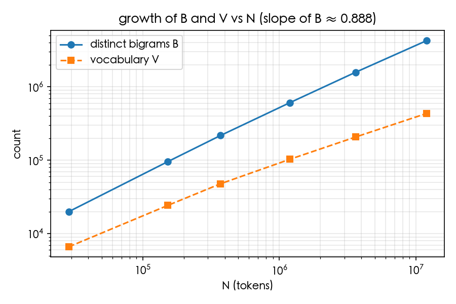

# Q4 語料量增加時相異 bigram 的成長

V 不含 `<s>`、`</s>`，與 Q3 一致。

| 比例 | 篇數 | N | V | B | B/N | 計數秒數 |
|---|---|---|---|---|---|---|
| 0.1% | 13 | 28,749 | 6,630 | 19,978 | 0.695 | 0.0 |
| 1% | 132 | 152,648 | 24,299 | 95,848 | 0.628 | 0.01 |
| 3% | 396 | 371,780 | 47,928 | 217,747 | 0.586 | 0.01 |
| 10% | 1,323 | 1,193,883 | 103,065 | 607,947 | 0.509 | 0.04 |
| 30% | 3,969 | 3,619,976 | 207,252 | 1,579,190 | 0.436 | 0.1 |
| 100% | 13,230 | 12,013,994 | 434,997 | 4,265,006 | 0.355 | 0.35 |

log-log 擬合：B ∝ N^0.888

